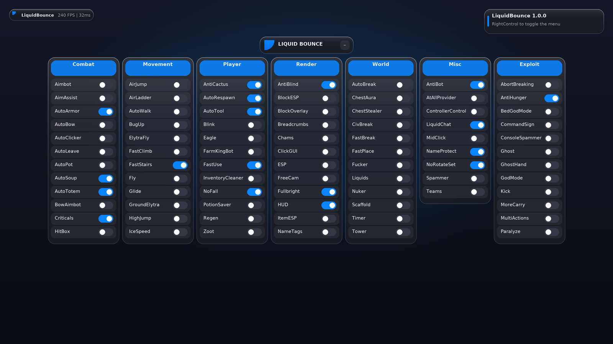

# LiquidBounce — Luau UI library for Roblox

Dark **liquid glass** ClickGUI in the spirit of LiquidBounce: translucent panels,
blurred backdrop, specular edge highlights, heavy corner rounding (14–24 px) and the
logo's blue accent (`#0A84FF`). The droplet logo is drawn in code — no image assets.



## Files

| File | What it is |
| --- | --- |
| `LiquidBounce.lua` | The library. Drop-in, no dependencies. |
| `Example.lua` | Demo script with the full classic module set (Combat, Movement, Player, Render, World, Misc, Exploit, Fun). |
| `preview.png` | Rendered preview of the `columns` layout. |
| `NeverLoseUI.lua` | Pre-existing unrelated library in this repo, untouched. |

## Loading

The library currently lives on the `arena/884cf208-ui` branch, **not on `main`** — a URL
pointing at `/main/LiquidBounce.lua` returns a 404 page, `loadstring` returns `nil`, and
you get `attempt to index nil with 'CreateWindow'`. Use one of these:

```lua
-- 1. direct (branch URL, works today)
local LiquidBounce = assert(loadstring(game:HttpGet(
    "https://raw.githubusercontent.com/gghgdw5/UI/arena/884cf208-ui/LiquidBounce.lua", true)))()

-- 2. after the library is merged into main
local LiquidBounce = assert(loadstring(game:HttpGet(
    "https://raw.githubusercontent.com/gghgdw5/UI/main/LiquidBounce.lua", true)))()

-- 3. library file next to your script
local LiquidBounce = assert(loadstring(readfile("LiquidBounce.lua")))()
```

`Example.lua` already contains a loader that tries the branch URL first and falls back to
`main`, and raises a readable error (`[LiquidBounce] could not load the library: ...`)
instead of returning `nil`.

Creating a second instance automatically unloads the previous one, so re-executing does
not stack GUIs.

## Window

```lua
local Window = LiquidBounce:CreateWindow({
    Title = "LiquidBounce",
    Subtitle = "v1.0.0",
    ToggleKey = Enum.KeyCode.RightControl, -- also accepts "RightControl"
    Layout = "columns",                    -- "columns" (default) or "sidebar"
    Size = { 1310, 640 },                   -- optional, pixels
    Watermark = true,                      -- FPS / ping chip, on by default
})
```

**`columns`** (default) rebuilds the classic ClickGUI: one glass column per category side
by side, blue gradient headers, module rows with rounded toggles, collapsible sections,
and a floating `LIQUID BOUNCE` title bar above the columns that drags the menu. Hiding it
leaves the title bar on screen so the menu can be reopened by clicking it (or with the
toggle key).

**`sidebar`** is a single big glass window: logo + category list + search field on the
left, the selected category's cards on the right.

Window methods:

| Method | Description |
| --- | --- |
| `Window:AddTab({ Title, Icon })` | Adds a category column / sidebar entry and returns the tab. |
| `Window:SelectTab(tab)` | Switches the active tab (`columns` layout shows all tabs at once). |
| `Window:GetTab(name)` | Finds a tab by title, case-insensitive. |
| `Window:Toggle(force)` / `Window:IsOpen()` | Show/hide the menu. |
| `Window:SetToggleKey(key)` | Changes the hotkey. |
| `Window:Destroy()` | Removes this window only. |

## Tabs, sections and controls

```lua
local Combat = Window:AddTab({ Title = "Combat" })
local Modules = Combat:AddSection("Modules")     -- collapsible glass card

Modules:AddToggle({
    Title = "KillAura",
    Default = false,
    Flag = "killaura",              -- optional, defaults to a slug of the title
    Callback = function(value) end,
})
```

All `Add*` calls take a table and return a control with `:Set(value, silent)` and `:Get()`.

| Control | Options |
| --- | --- |
| `AddToggle` | `Title`, `Default`, `Callback`, `Flag` |
| `AddSlider` | `Min`, `Max`, `Default`, `Step`, `Suffix`, `Callback` |
| `AddDropdown` | `Options`, `Default`, `Callback` |
| `AddMultiDropdown` | `Options`, `Default` (table), `Callback` (called with the list) |
| `AddKeybind` / `AddBind` | `Default` (`Enum.KeyCode`, `Enum.UserInputType` or `"E"`) |
| `AddTextbox` / `AddInput` | `Default`, `Placeholder`, `Callback` (fires on Enter) |
| `AddColorpicker` / `AddColorPicker` | `Default` (`Color3` or `"#0A84FF"`) |
| `AddButton` | `Accent`, `Callback` |
| `AddLabel` | `Title` (text) |
| `AddParagraph` | `Text` (wrapped body text) |
| `AddDivider` | — |

Controls can also be added straight to a tab — they go into its last section, or into an
auto-created `General` section:

```lua
Combat:AddSlider({ Title = "FOV", Min = 10, Max = 360, Default = 120, Suffix = "°" })
```

## Notifications, configs, unload

```lua
LiquidBounce:Notify({ Title = "Injected", Text = "RightControl to open", Duration = 5, Icon = "!" })
LiquidBounce:SaveConfig("pvp")      -- writes LiquidBounce/configs/pvp.json
LiquidBounce:LoadConfig("pvp")
LiquidBounce:GetConfigList()        -- { "pvp", ... }
LiquidBounce:Unload()               -- alias: :Destroy()
```

`SaveConfig` / `LoadConfig` need executor functions (`writefile`, `readfile`, `makefolder`,
`listfiles`); without them they warn and return `false` instead of erroring.

## Theme

```lua
LiquidBounce.Theme.Accent = Color3.fromRGB(10, 132, 255) -- logo blue
LiquidBounce.Theme.Card   = Color3.fromRGB(26, 28, 36)
LiquidBounce.Settings.Blur = true      -- BlurEffect in Lighting (read at window creation)
LiquidBounce.Settings.BlurSize = 18
```

Theme keys: `Accent`, `AccentDark`, `Background`, `Card`, `Stroke`, `Text`, `SubText`,
`ToggleOff`, `WindowTransparency`, `CardTransparency`.

## Layout notes

* Every panel is a `CanvasGroup`/`Frame` with a `UICorner`, a hairline `UIStroke`, a
  second top-only specular stroke and a gradient sheen — that combination is what reads as
  "liquid glass" in-engine (a `BlurEffect` in `Lighting` supplies the refraction).
* Sections use `AutomaticSize = Y`, so cards grow with their content and stay crisp at any
  scale; controls inside a card are laid out by a `UIListLayout`.
* Dropdowns, multi-dropdowns and the colour picker open in a popup reparented to the
  ScreenGui, clamped to the viewport, and close on outside click.
